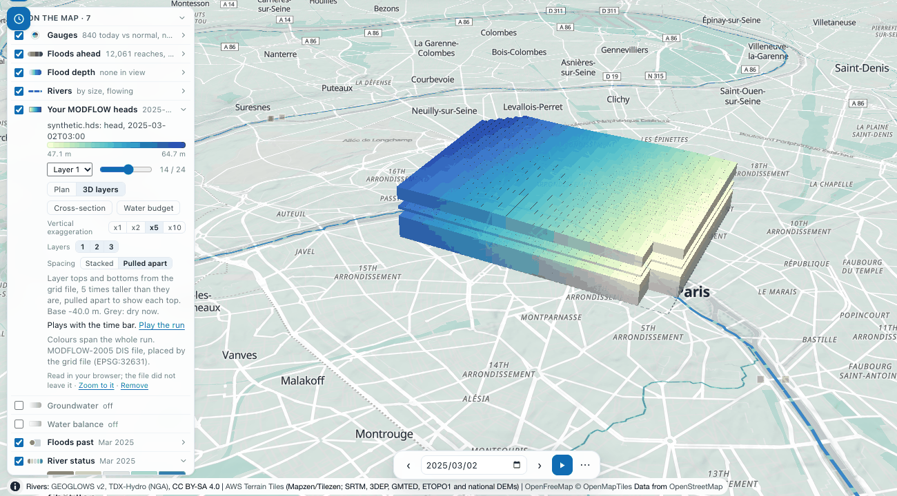
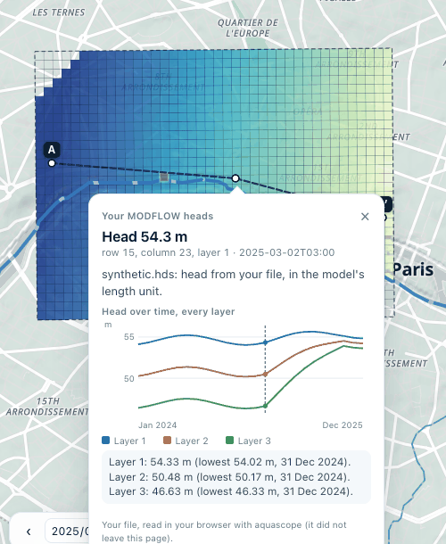
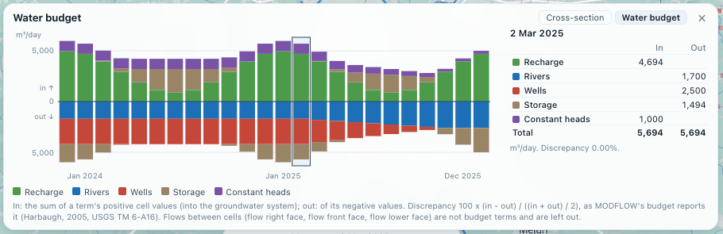

# MODFLOW heads on the map

`aquascope.groundwater.surface.read_modflow_heads` reads a MODFLOW binary head file and
places its cells on the Earth, so a model's heads can be drawn on a map, the way ModelMuse,
FloPy and GMS show them. The Explorer uses it when you drop a model on the globe, and the
CLI and the MCP server expose the same function.


## What it reads

- **Heads**: the binary head file (`.hds`, `.hed`, `.bhd`) of MODFLOW-2005 or MODFLOW 6,
  single or double precision, any number of layers and time steps. A drawdown file reads
  the same way. Each record is a 44-byte header in single precision (52 in double:
  `kstp, kper, pertim, totim`, a 16-character text, `ncol, nrow, ilay`), then
  `nrow * ncol` values; the precision is told from the first header. Inactive and dry
  cells (|h| of 1e20 and more, or -999.99 and the like) have no head. Unstructured
  (DISU) files are not read.
- **The grid**, from one of:
  - a MODFLOW 6 `.dis` or `.disv` text file (`DELR` and `DELC` as `CONSTANT` or
    `INTERNAL`; `XORIGIN`, `YORIGIN`, `ANGROT`, `LENGTH_UNITS` from its options),
  - a MODFLOW-2005 `.dis` (with FloPy's georeference comment when it has one),
  - a MODFLOW 6 binary grid file (`.dis.grb` or `.disv.grb`), which holds every array
    whatever the input used, so it is the way round `OPEN/CLOSE` arrays,
  - or a cell size, for a regular grid.
- **Where and when**, when the grid does not say: a `.nam` with the comment FloPy writes
  (`xul`/`yul` or `xll`/`yll`, `rotation`, `proj4_str` or `epsg`, `start_datetime`), a
  MODFLOW 6 `.tdis` (`TIME_UNITS`, `START_DATE_TIME`), or what you type: the lower-left
  corner, the rotation (degrees counter-clockwise) and the CRS (an EPSG code).

Cells come back as polygons in lon/lat (projected with pyproj) and heads as an array of
time x layer x cell. A DIS grid with more than 60,000 cells per layer is drawn in blocks
of k x k cells (their mean head), and the result says so; a DISV grid that large is
refused.

## Checked against FloPy

On FloPy's own examples (CC0, `examples/data/mf6-freyberg` and
`examples/data/freyberg_multilayer_transient`, read on 2026-10-11, not committed) the
heads are identical to `flopy.utils.HeadFile`'s, value for value, in single and double
precision (one time step on one layer, and 1,097 time steps on three layers), and the
placed corners match FloPy's `StructuredGrid` with the same origin and rotation. A test
compares the two on synthetic files wherever FloPy is installed.

Why not FloPy itself: FloPy 3.11.0 installs with micropip in the Explorer's Pyodide 314
and reads a `.hds` there (checked on 2026-10-11). But `import flopy` imports matplotlib,
so the page would download about 10 MB more (matplotlib 7.0 MB, fonttools 1.2 MB,
Pillow 1.0 MB, the FloPy wheel 1.5 MB, and a few small ones) to read a file whose layout
fits on a page. The reader here is plain numpy and imports on a bare install.

## Use it

In the Explorer: drop the `.hds` with its grid (and the `.nam` if FloPy wrote one) on the
map, or use **Tools**, **Open model results**, or **Groundwater** in the legend, then
**Your MODFLOW heads**. The files are read in your browser's worker and do not leave it.
Pick the layer, step through the times with the slider, or play the run with the time bar
when the model has dates. A click on a cell gives its head. See
[the Explorer](explorer.md#groundwater).

**No model at hand?** **Tools**, **Open model results**, **MODFLOW: the Freyberg model**
fetches FloPy's transient Freyberg example (`freyberg.nam`, `.dis` and `.hds`, 10.8 MB,
public domain) from FloPy's GitHub repository, pinned to one commit, and opens it like a
drop. Its `.nam` places it.

**A model whose files do not say where it is** is never refused. The first choice is
**Place it at the centre of the map (approximate)**: one click, north up, at its true size
in its own length unit (metres when the files name none). The legend row and the cell card
say "approximate placement"; the heads are the model's, the place is not. The second choice
is the exact form (lower-left corner, rotation, CRS), also reachable later from the legend
row with **Place it exactly**. In Python the same is
`read_modflow_heads(..., approximate_at=[lon, lat])`.

```bash
aquascope modflow model.hds --grid model.dis.grb --crs EPSG:27700 --origin 450000 120000
aquascope modflow freyberg.hds --grid freyberg.dis --sidecar freyberg.nam --layer 2 --geojson heads.geojson
aquascope modflow heads.hds --cell-size 100 --origin 0 0 --crs EPSG:32631 --start-date 2020-01-01
```

```python
from aquascope.groundwater.surface import modflow_geojson, modflow_summary, read_modflow_heads

res = read_modflow_heads("freyberg.hds", "freyberg.dis", sidecars=["freyberg.nam"])
modflow_summary(res, time_index=-1, layer=1)    # the grid, times, dates, range and one frame, JSON-safe
modflow_geojson(res, time_index=0, layer=3)     # that frame's cells with their head
```

The MCP tool `modflow_heads(hds_path, grid_path, ...)` returns the summary and, with
`geojson=True`, the frame's cells. When the model's place is unknown the answer says what
is missing (`needs`: `grid`, `origin`, `crs`).

What it is not: a model run. It reads what MODFLOW wrote; heads are in the model's own
length unit.

## Layers, sections, hydrographs and the water budget

Experimental (see [Stability](stability.md#experimental)), added after 0.27.0 for #625 and
#626: `aquascope.groundwater.layers` and `aquascope.groundwater.budget`.





- `read_layer_elevations(grid)`: each layer's top and bottom (`TOP`, `BOTM`, `IDOMAIN`) from a
  MODFLOW 6 `.dis`/`.disv` or `.dis.grb`, or a MODFLOW-2005 `.dis` (a confining bed under a
  layer, `LAYCBD`, is skipped). Checked against FloPy's `ModflowDis` on the Freyberg example.
- `model_layers(res, grid)`: those elevations on the cells as `read_modflow_heads` draws them
  (block means on a big grid), the model's base and crest, and a vertical exaggeration for a
  3D view: 1, 2 or 5 times a power of ten, so the stack stands about 12% of the model's width.
- `cross_section(res, layers, [[lon, lat], ...])`: the cells a line crosses, in order, with
  where it enters and leaves each (found to half a metre), every layer's top, bottom and head
  at every saved time, and the water table, read as the head of the uppermost layer that has
  one. Distances are on a local plane around the line (well under 1% from the geodesic over
  a model's few tens of kilometres).
- `cell_hydrograph(res, cell, layers)`: one cell's head over time in every layer, with its
  lowest value and when, and the layer's top and bottom.
- `read_budget(cbc)` and `water_budget(cbc, heads=res)`: the cell-by-cell budget file in
  every layout MODFLOW writes: the full layout (MODFLOW-2005 without `COMPACT BUDGET`), the
  compact one (IMETH 1 to 5) and MODFLOW 6's (IMETH 6), in single or double precision, told
  from the file. Per saved time and term, **in** is the sum of the term's positive cell values
  (water entering the groundwater system) and **out** of its negative ones; the percent
  discrepancy is `100 * (IN - OUT) / ((IN + OUT) / 2)`, as MODFLOW's own budget reports it
  ([Harbaugh, 2005](https://doi.org/10.3133/tm6A16)). Flows between cells (`FLOW RIGHT FACE`,
  `FLOW-JA-FACE` and the like) and MODFLOW 6's `DATA-` records are not budget terms and are
  left out. Rates are in the model's length cubed per its time unit. The layouts are those of
  the MODFLOW-2005 documentation (its
  [Output Control page](https://water.usgs.gov/ogw/modflow/MODFLOW-2005-Guide/output_control.htm))
  and of FloPy's
  [`CellBudgetFile`](https://flopy.readthedocs.io/en/latest/source/flopy.utils.binaryfile.html);
  a test checks the reader against FloPy where FloPy is installed.



```bash
aquascope modflow synthetic.hds --grid synthetic.dis --sidecar synthetic.nam --time 13 \
  --layers --section 2.29,48.864 2.35,48.864 --cell 15 23 --budget synthetic.cbc
```

```python
from aquascope.groundwater import budget, views
from aquascope.groundwater.surface import read_modflow_heads

res = read_modflow_heads("synthetic.hds", "synthetic.dis", sidecars=["synthetic.nam"])
lay = views.model_layers(res, "synthetic.dis")
sec = views.cross_section(res, lay, [[2.29, 48.864], [2.35, 48.864]])
views.section_summary(sec, time_index=13)       # the cells, tops, bottoms, heads and water table, JSON-safe
views.cell_hydrograph(res, 14 * 40 + 22, lay)    # row 15, column 23: every layer's head over the run
wb = budget.water_budget("synthetic.cbc", heads=res)
budget.budget_at(wb, 13)                         # each term's in, out and net, the totals and the discrepancy
```

The MCP tool `modflow_heads` takes the same as `section`, `cell_row`/`cell_col` and
`budget_path`. The synthetic three-layer model these pictures come from (a sand, a clay and
a chalk with a pumping well, everything made up) is written by
`tests/test_groundwater/synthetic_models.py OUT_DIR`.
